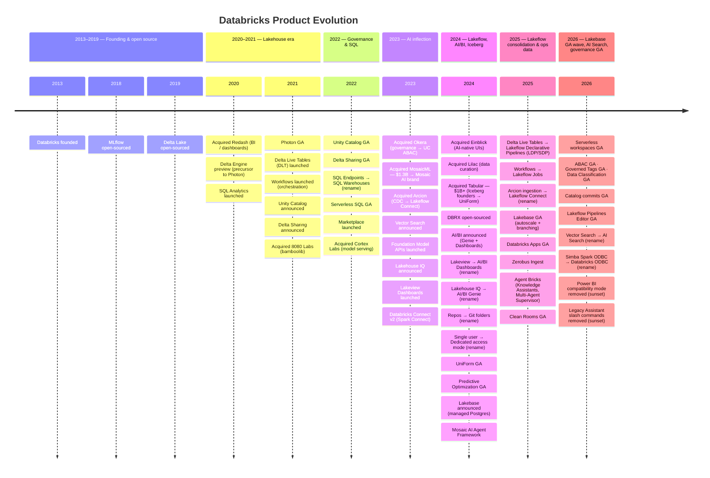
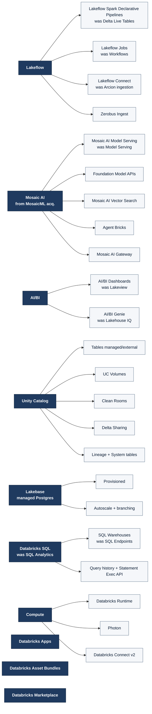

# Databricks Product Evolution

> Visual reference of the product map: launches, renames, sunsets, and acquisitions. Source for [product-evolution.png](product-evolution.png) (the rendered timeline).
> Last refresh: 2026-06-04.

---

## Timeline (rendered → product-evolution.png)



---

## Acquisitions

| Year | Acquired | Why | Where it shows up today |
|---|---|---|---|
| 2020 | **Redash** | Open-source SQL/dashboards | Roots of Databricks SQL queries + legacy dashboards |
| 2021 | **8080 Labs** | `bamboolib` pandas UI | Notebook pandas-style explorer |
| 2022 | **Cortex Labs** | ML model serving infra | Mosaic AI Model Serving foundations |
| 2023 | **Okera** | Fine-grained data access governance | UC ABAC, row filters, column masks |
| 2023 | **MosaicML** ($1.3B) | Foundation model training & inference | The **Mosaic AI** brand; Foundation Model APIs |
| 2023 | **Arcion** | CDC for databases (Oracle/SQL Server/…) | Lakeflow Connect (database connectors) |
| 2024 | **Einblick** | AI-native data app interfaces | Influence on AI/BI Genie UX |
| 2024 | **Lilac** | Data curation / quality for AI | Data quality tooling for GenAI eval |
| 2024 | **Tabular** ($1B+) | Apache Iceberg co-founders | **Delta UniForm** strategy; Iceberg interop |

---

## Multi-rename chains

Product lines that were renamed **more than once**. Shown as their own section in `product-evolution.png`.

| Original | Intermediate | Current | Years |
|---|---|---|---|
| **Delta Live Tables** (DLT) | Lakeflow Declarative Pipelines | **Lakeflow Spark Declarative Pipelines** (LDP / SDP) | 2021 → 2024 → 2025 |
| **Single-user cluster type** | Single user (access mode) | **Dedicated** (access mode) | pre-2022 → 2022 → 2024 |
| **High Concurrency cluster** | Shared (access mode) | **Standard** (access mode) | pre-2022 → 2022 → 2024 |

Other product lines are close-to-chains but only had a single rename event (e.g., SQL Endpoints → SQL Warehouses; Lakeview → AI/BI Dashboards; Workflows → Lakeflow Jobs) — those live in the single-rename table below.

## Renames (old → new)

| Old name | New name | Approx. year | Notes |
|---|---|---|---|
| SQL Analytics | **Databricks SQL** (DBSQL) | 2021–22 | Product brand rename |
| SQL Endpoints | **SQL Warehouses** | 2022 | Terminology change |
| Lakeview Dashboards | **AI/BI Dashboards** | 2024 | Folded into AI/BI brand |
| Lakehouse IQ | **AI/BI Genie** | 2024 | NL-to-SQL surface |
| Delta Live Tables (DLT) | **Lakeflow Spark Declarative Pipelines** (LDP / SDP) | 2024–25 | Lakeflow brand consolidation |
| Workflows | **Lakeflow Jobs** | 2025 | Lakeflow brand consolidation |
| Arcion-derived ingestion | **Lakeflow Connect** | 2024–25 | Lakeflow brand consolidation |
| Repos | **Git folders** | 2024 | Workspace integration rename |
| Single user (access mode) | **Dedicated** | 2024 | Cluster access-mode rebrand |
| Shared (access mode) | **Standard** | 2024 | Cluster access-mode rebrand |
| Workspace Model Registry | **Models in UC** | 2023–24 | Governance migration |
| Files in Repos | **Workspace Files** | 2023 | Unified file model |
| Databricks Connect v1 (RPC) | **Databricks Connect v2** (Spark Connect) | 2023 | Underlying protocol change |
| Lakehouse Federation (initial name "Query Federation") | **Lakehouse Federation** | 2023 | Branding stabilized |
| (Various) Model Serving | **Mosaic AI Model Serving** | 2023–24 | Folded into Mosaic AI brand |

---

## Sunsets / deprecations

| Old | Replacement | Status |
|---|---|---|
| **High-concurrency clusters** | Shared/Standard access mode | Deprecated ~2022 |
| **Hive Metastore (HMS)** for new workloads | **Unity Catalog** | Legacy; migrate |
| **Table ACLs** (pre-UC) | UC privileges | Replaced |
| **Databricks Connect v1** (RPC) | Databricks Connect v2 (Spark Connect) | Removed |
| **Cluster-scoped init scripts** | Workspace-scoped init scripts | Removed 2024 |
| **Z-order** | **Liquid clustering** | Legacy; still works |
| **`PARTITIONED BY` for new tables** | Liquid clustering | Legacy default in most cases |
| **AutoML** (workspace UI flavor) | Mosaic AI tooling + custom code | Deprecated |
| **DBFS root mounts for prod data** | UC Volumes + External Locations | Legacy |
| **No-isolation shared access mode** | Standard / Dedicated | Deprecated |
| **Notebook "old UI"** | New notebook UI | Removed 2023 |

---

## Brand-family map (current state)



---

## Feature-level timelines (per product)

`product-evolution.png` is the product-level view. For **feature-level** evolution — every GA / Public Preview / Beta / Update from `docs.databricks.com/aws/en/release-notes/product/` — see the per-product timelines in `by-product/`:

| Bucket | What it covers |
|---|---|
| `lakeflow` | Jobs · SDP/LDP · Connect · Auto Loader · Zerobus |
| `unity-catalog` | UC governance · Volumes · Clean Rooms · Delta Sharing · system tables · Catalog Commits |
| `delta-lake` | Liquid clustering · Predictive Optimization · Deletion Vectors · UniForm · CDF |
| `databricks-sql` | SQL Warehouses · alerts · Statement Execution · AI functions · MVs |
| `aibi` | AI/BI Dashboards · Genie |
| `mosaic-ai` | Model Serving · Vector Search · FMAPI · Agent Bricks · Gateway · MLflow · Feature Eng |
| `lakebase` | Managed Postgres (autoscale, branching, sync) |
| `compute` | DBR · Photon · serverless · Databricks Connect · access modes |
| `apps-ecosystem` | Apps · Asset Bundles · Marketplace |
| `workspace` | Notebooks · Git folders · workspace files · Excel/Sheets · unified runs |
| `security` | Auth · PrivateLink · NCC · audit · identity management |

Refresh weekly/monthly with one command:

```bash
./refresh.sh                   # last 12 months (default)
./refresh.sh 2025-01 2026-05   # explicit range
```

That runs:

1. **`feature-scraper.py`** — fetches monthly release-notes pages, extracts `(date, title, slug, status, url)` per entry.
2. **`feature-classifier.py`** — buckets each event via Anthropic API (Haiku 4.5, batched JSON) if `ANTHROPIC_API_KEY` is set; otherwise falls back to keyword scan.
3. **`feature-timeline.py`** — writes one SVG per bucket to `by-product/`, then `rsvg-convert` each to PNG.

For the proper LLM classification, set the key once:

```bash
export ANTHROPIC_API_KEY=sk-ant-...
./refresh.sh
```

## How to refresh

The actual rendered PNG (`product-evolution.png`) is generated from **`product-evolution.svg`** (hand-authored SVG XML, same approach used in `../../Flightschool/*.svg`). The mermaid blocks in this doc and `product-evolution.mmd` are kept as a secondary source you can paste into any mermaid viewer.

```bash
# Edit product-evolution.svg, then:
rsvg-convert -w 2400 product-evolution.svg -o product-evolution.png
```

Why not mermaid-cli? `mmdc` requires Puppeteer + headless Chromium, which hangs on Chrome 148 on this machine. `rsvg-convert` (libRSVG, `brew install librsvg`) renders SVG directly with no browser dependency and is what the rest of `~/Documents/Automation/` uses.

If you need to refresh from the mermaid source instead (e.g., from a different machine where `mmdc` works):

```bash
npx -y @mermaid-js/mermaid-cli@latest \
  -i product-evolution.mmd -o product-evolution.png \
  --backgroundColor white --width 2400
```

## Sources

- Public Databricks blog posts and release notes (acquisitions, GA announcements, rebrands).
- Companion product docs in `../` — each product folder's L100–L400 page tracks the current name and any prior aliases (e.g., `LakeflowSparkDeclarativePipelines/` lists aliases `[LDP, DLT, Delta Live Tables]`).
- [Glossary](../Glossary/glossary.md) for cross-cutting term definitions.
