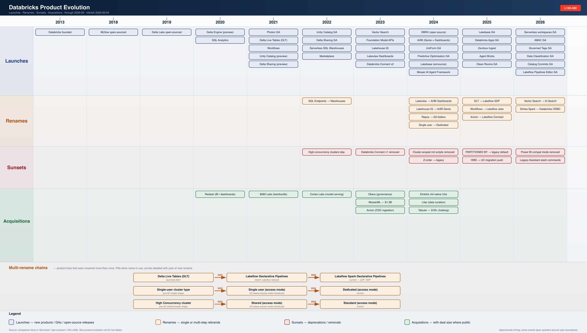

# Databricks Product Docs

An L100 → L400 reference set for every major Databricks product, with anti-patterns and weaknesses called out. Field-engineer voice, no marketing fluff.

> Author: Troy Kirkland · Manifest: [`_control.yaml`](./_control.yaml) (edit to add/remove products)

**Start here:** [Glossary](./Glossary/glossary.md) · [Product Evolution](./ProductEvolution/product-evolution.md) · [Lakeflow Connect (the original)](./LakeflowConnect/lakeflow-connect.md)

---

## Cross-cutting Topics

- **[Storage on Databricks](./Storage/storage.md)** — Cross-cutting L100–L400: cloud object storage + Delta Lake + UC governance + optimization machinery, synthesized into one read.
- **[Compute on Databricks](./Compute/compute.md)** — Cross-cutting L100–L400: Spark + Photon on classic vs serverless; clusters, SQL warehouses, Databricks Connect, runtime internals.
- **[Product Evolution Timeline](./ProductEvolution/product-evolution.md)** — Launches · renames · sunsets · acquisitions · multi-rename chains. [PNG](./ProductEvolution/product-evolution.png) · [SVG](./ProductEvolution/product-evolution.svg)

---

## Data Engineering & Ingestion

- **[Lakeflow Connect](./LakeflowConnect/lakeflow-connect.md)** — Managed ingestion for SaaS apps, CDC databases, and files into UC streaming tables. · [📈 timeline](./ProductEvolution/by-product/lakeflow.png)
- **[Lakeflow Spark Declarative Pipelines](./LakeflowSparkDeclarativePipelines/lakeflow-spark-declarative-pipelines.md)** *(LDP / DLT)* — Declarative ETL framework: streaming tables, materialized views, APPLY CHANGES INTO, expectations. · [📈 timeline](./ProductEvolution/by-product/lakeflow.png)
- **[Lakeflow Jobs](./LakeflowJobs/lakeflow-jobs.md)** *(Workflows)* — Orchestrator for tasks, dependencies, triggers, repair runs. · [📈 timeline](./ProductEvolution/by-product/lakeflow.png)
- **[Auto Loader](./AutoLoader/auto-loader.md)** — Incremental file ingestion (cloudFiles) with schema inference and evolution. · [📈 timeline](./ProductEvolution/by-product/lakeflow.png)
- **[Zerobus Ingest](./ZerobusIngest/zerobus-ingest.md)** — gRPC direct-to-Delta low-latency ingest SDK; Kafka-less event landing. · [📈 timeline](./ProductEvolution/by-product/lakeflow.png)

## Storage & Format

- **[Delta Lake](./DeltaLake/delta-lake.md)** — ACID transactional storage layer: transaction log, OPTIMIZE, liquid clustering, CDF, time travel. · [📈 timeline](./ProductEvolution/by-product/delta-lake.png)
- **[Delta Sharing](./DeltaSharing/delta-sharing.md)** — Open protocol for sharing live data across orgs/clouds without copy. · [📈 timeline](./ProductEvolution/by-product/unity-catalog.png)

## Compute & Runtime

- **[Databricks Runtime](./DatabricksRuntime/databricks-runtime.md)** *(DBR)* — Versioned Spark + Photon + libraries runtime; LTS, ML, and GPU variants. · [📈 timeline](./ProductEvolution/by-product/compute.png)
- **[Photon](./Photon/photon.md)** — C++ vectorized execution engine accelerating Spark SQL and Delta. · [📈 timeline](./ProductEvolution/by-product/compute.png)
- **[Databricks Connect](./DatabricksConnect/databricks-connect.md)** — Local-IDE to remote-cluster Spark Connect bridge for dev loop. · [📈 timeline](./ProductEvolution/by-product/compute.png)

## SQL & Analytics

- **[Databricks SQL](./DatabricksSQL/databricks-sql.md)** *(DBSQL, SQL Warehouses)* — Serverless / Pro / Classic warehouses, query history, alerts, Statement Execution API. · [📈 timeline](./ProductEvolution/by-product/databricks-sql.png)
- **[AI/BI Dashboards](./AIBIDashboards/aibi-dashboards.md)** *(Lakeview)* — Lakehouse-native dashboarding: datasets, widgets, parameters, subscriptions. · [📈 timeline](./ProductEvolution/by-product/aibi.png)
- **[AI/BI Genie](./AIBIGenie/aibi-genie.md)** — Natural-language to SQL Genie Agents (formerly Genie Spaces); instructions, example queries, trust signals. · [📈 timeline](./ProductEvolution/by-product/aibi.png)
- **[Lakehouse Federation](./LakehouseFederation/lakehouse-federation.md)** — Foreign catalogs that query Snowflake/Postgres/SQLServer/BQ/Redshift without copy. · [📈 timeline](./ProductEvolution/by-product/databricks-sql.png)

## Governance

- **[Unity Catalog](./UnityCatalog/unity-catalog.md)** *(UC)* — Metastore for tables, models, volumes, ML assets; lineage, ABAC, row/column masks. · [📈 timeline](./ProductEvolution/by-product/unity-catalog.png)
- **[UC Volumes](./UCVolumes/uc-volumes.md)** — Governed non-tabular storage abstraction (/Volumes); managed vs external. · [📈 timeline](./ProductEvolution/by-product/unity-catalog.png)
- **[Clean Rooms](./CleanRooms/clean-rooms.md)** — Multi-party data collaboration with approved-query gating; UC-native. · [📈 timeline](./ProductEvolution/by-product/unity-catalog.png)

## AI / ML

- **[MLflow on Databricks](./MLflow/mlflow.md)** — Experiment tracking, GenAI tracing, evaluation, registered models in UC. · [📈 timeline](./ProductEvolution/by-product/mosaic-ai.png)
- **[Mosaic AI Model Serving](./MosaicAIModelServing/mosaic-ai-model-serving.md)** — Serverless model endpoints: CPU/GPU, scale-to-zero, external models, payload tables. · [📈 timeline](./ProductEvolution/by-product/mosaic-ai.png)
- **[Mosaic AI Vector Search](./MosaicAIVectorSearch/mosaic-ai-vector-search.md)** — Delta-synced vector indexes; hybrid search, storage-optimized endpoints. · [📈 timeline](./ProductEvolution/by-product/mosaic-ai.png)
- **[Agent Bricks](./AgentBricks/agent-bricks.md)** — Eval-driven agent builder: Knowledge Assistants, Genie Agents, Multi-Agent Supervisor. · [📈 timeline](./ProductEvolution/by-product/mosaic-ai.png)
- **[Unity Gateway](./MosaicAIGateway/mosaic-ai-gateway.md)** *(formerly Mosaic AI Gateway)* — Governance/policy layer in front of model endpoints, agents, and MCP servers: rate limits, PII, fallback, smart routing, logging. · [📈 timeline](./ProductEvolution/by-product/mosaic-ai.png)
- **[Foundation Model APIs](./FoundationModelAPIs/foundation-model-apis.md)** *(FMAPI)* — Pay-per-token and provisioned-throughput hosted foundation models. · [📈 timeline](./ProductEvolution/by-product/mosaic-ai.png)
- **[Feature Engineering in Unity Catalog](./FeatureEngineeringInUC/feature-engineering-in-uc.md)** *(Feature Store)* — Feature tables, online tables, point-in-time joins, training-serving parity. · [📈 timeline](./ProductEvolution/by-product/mosaic-ai.png)

## Apps & Operations

- **[Databricks Apps](./DatabricksApps/databricks-apps.md)** — Hosted Python/Node web apps: Streamlit/Dash/Flask/FastAPI/React; app.yaml + resources. · [📈 timeline](./ProductEvolution/by-product/apps-ecosystem.png)
- **[Declarative Automation Bundles](./DatabricksAssetBundles/databricks-asset-bundles.md)** *(DAB · formerly Databricks Asset Bundles)* — YAML-defined deployable bundles of jobs, pipelines, dashboards, apps for CI/CD. · [📈 timeline](./ProductEvolution/by-product/apps-ecosystem.png)
- **[Databricks Marketplace](./DatabricksMarketplace/databricks-marketplace.md)** — Open exchange for data products, AI models, notebooks; Delta-Sharing delivery. · [📈 timeline](./ProductEvolution/by-product/apps-ecosystem.png)

## Operational Data

- **[Lakebase](./Lakebase/lakebase.md)** — Managed Postgres on Databricks: provisioned + autoscale + branching; OLTP companion to lakehouse.

## Feature Timelines (by product)

GA / Public Preview / Beta / Update events for each product bucket, scraped from `docs.databricks.com/aws/en/release-notes/product/` and rendered as month-by-month timelines. Last 12 months (2025-10 → 2026-09) · counts as of 2026-10-02 (in-session LLM classification).

| Product | Events | Covers |
|---|---:|---|
| [Mosaic AI](./ProductEvolution/by-product/mosaic-ai.png) | 117 | Model Serving · Vector Search · FMAPI · Agent Bricks · Unity Gateway · MLflow · Feature Eng |
| [Lakeflow](./ProductEvolution/by-product/lakeflow.png) | 104 | Jobs (was Workflows) · SDP/LDP (was DLT) · Connect · Auto Loader · Zerobus |
| [Workspace & Notebooks](./ProductEvolution/by-product/workspace.png) | 52 | Notebooks · Git folders · workspace files · Excel/Sheets · unified runs |
| [Unity Catalog](./ProductEvolution/by-product/unity-catalog.png) | 45 | Governance · Volumes · Clean Rooms · Delta Sharing · ABAC · system tables |
| [Security & Networking](./ProductEvolution/by-product/security.png) | 39 | Auth · PrivateLink · NCC · audit · identity management · PAT |
| [Compute & Runtime](./ProductEvolution/by-product/compute.png) | 31 | DBR · Photon · serverless · Databricks Connect · access modes · GPU |
| [AI/BI](./ProductEvolution/by-product/aibi.png) | 19 | AI/BI Dashboards (was Lakeview) · AI/BI Genie · Genie Agents · metric views |
| [Delta Lake](./ProductEvolution/by-product/delta-lake.png) | 16 | Liquid clustering · Predictive Optimization · Deletion Vectors · UniForm · CDF |
| [Databricks SQL](./ProductEvolution/by-product/databricks-sql.png) | 14 | SQL Warehouses · alerts · Statement Execution · AI functions · materialized views |
| [Apps & Ecosystem](./ProductEvolution/by-product/apps-ecosystem.png) | 8 | Databricks Apps · Asset Bundles · Marketplace |

Refresh with `ProductEvolution/refresh.sh`. Pipeline: [`feature-scraper.py`](./ProductEvolution/feature-scraper.py) → [`feature-classifier.py`](./ProductEvolution/feature-classifier.py) → [`feature-timeline.py`](./ProductEvolution/feature-timeline.py). Raw JSON: [`features-classified.json`](./ProductEvolution/features-classified.json).

---

## About this doc set

Every product page follows the same structure: **L100** (what it is) → **L200** (product surface) → **L300** (architecture) → **L400** (deep internals) → **Anti-patterns** → **Weaknesses** → **Sources**. Cross-cutting terms are defined once in the [Glossary](./Glossary/glossary.md).

To **add or edit a product**: edit [`_control.yaml`](./_control.yaml) (set `status: pending` or `needs-update`), then re-run the regeneration prompt described at the bottom of the control file.
